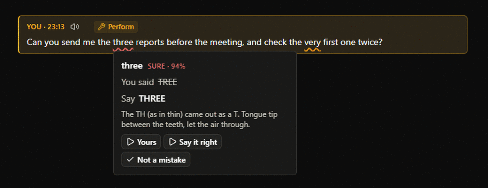

# prifly-ext-pronunciation



_A sent message with two marked words, and the card that opens on one of them (invented sentence)._

A prifly extension that listens to your English dictation and puts a wavy
underline under words said with a German or Swedish accent feature. With the
caret in one, the hint under the message box says how to fix it. Pointing at
the word in a sent message opens a card: the word, "Sure · 94%", "You said"
the struck-through TREE, "Say THREE" and the fix line:

> **three** The TH (as in thin) came out as a T. Tongue tip between the teeth,
> let the air through.

The respellings (`pronounce/respell.ts`) are plain English, not IPA: the
stressed syllable in capitals, syllables joined by "-", and the swapped sound
doubled where it stands alone after a vowel (BROW-sser to BROW-zzer, THEESS to
THEEZZ). A mark is "sure" when the model gave the heard phone a posterior of at
least 0.88, and "maybe" from 0.70 up to that, unless `pronounce/data/thresholds.json`
(from `tools/calibrate`) sets other cut-offs for that check.

Settings → Extensions → Pronunciation → Underline picks which are drawn:
"Sure mistakes only" (the default), "Sure and not sure", or "Off" (nothing is
judged then). A change applies at once, to the marks already given too.

Listen is prifly's own. "Not a mistake" keeps that word with what was heard
in it, in `api.state`, and the pair is never marked again. A dictated word you
correct by hand is judged again as the corrected word. Pieces in other
languages are ignored, and dictation never waits on the extension: work runs
after the words are in the box, and while one request runs only the newest one
waits.

Settings → Extensions shows it as "Hears your dictation (with audio)".

## Yours and Say it right

With a prifly that has the feature "dictation-mark-audio" (not landed in prifly
yet; an older prifly gets no such buttons), a mark's card has two buttons under
"Say": **Yours** plays your own word, cut from the piece audio the extension
keeps for corrections, and **Say it right** plays your sentence said correctly
in your own voice, at your own speed. Both are 44.1 kHz wavs; nothing at 22
kHz or below is made or played. The card shows its spinner while the clip is
made; a clip is made on the first click and kept in `<prifly data>/pronunciation/voice/`.

Say it right is made like the research run's variant B (`pronounce/voice.ts`):

1. The sentence (the corrected word, for a correction) read by Edge TTS
   en-GB-RyanNeural, kept at its native 24 kHz.
2. Time-matched to you: Seed-VC's `--length-adjust` is your clip's length over
   the reading's (kept between 0.4 and 2.5).
3. Seed-VC `inference.py` with `--f0-condition True --auto-f0-adjust True
   --diffusion-steps 100 --inference-cfg-rate 0.7`, the 44.1 kHz model.
4. Your voice reference: the wav in "Your voice sample", or, when empty, your
   cleanest recent full-rate pieces (about 20 s).

Seed-VC needs a GPU, and prifly's extension api cannot rent one for an
extension on demand (`api.onRent` answers only the New session dialog's rent
row; `api.machines.report` only lists boxes), so the box is a setting: **Voice
box (ssh)** (`root@ssh2.vast.ai`), **Voice box port** and **Voice box key
file**. The first click puts `pronounce/box/runner.py` there and has it install
Seed-VC, edge-tts and ffmpeg (minutes, once); each clip after that is a few ssh
calls (`pronounce/box.ts`). The box costs money while it runs: stop it when
you are done.

Full-rate audio: prifly's piece audio is 16 kHz, and this extension never
plays that, nor that resampled up. It needs the piece's audio at the device's
own rate (`audioFull`, 48 kHz say; the feature "dictation-audio-full", extension
api 0.18, not landed yet). **Yours** is cut from it and played at that rate, and
without it there is no Yours button. The voice reference is made only from
full-rate pieces (or the wav in "Your voice sample"); with neither, Say it right
says it has no reference. `pronounce/play-shim.ts` holds the types of
"dictation-mark-audio" and `audioFull` until the package has them.

## What it marks

Only substitutions that are accent features: z to s, a final voiced consonant
gone voiceless, th said as t, s, f, d or z, w and v for each other, and sh, ch,
j, zh for one another. The piece's words are first aligned over the model's
output as one sentence (`pronounce/force-align.ts`, a CTC forced alignment), each
as the pronunciation the audio fits best, so Parakeet's word times, off by up to
440 ms, only bound where a word may go. A phone of that pronunciation is marked
when the model heard such a substitution there with a posterior of at least 0.7
(or its check's cut-off in `pronounce/data/thresholds.json`, where a check can
also be `"off"`), did not hear the expected phone there too, and no other
accepted pronunciation of the word (Britfone's British, CMUdict's American) has
the heard phone in that place. Only words Britfone has are judged. Vowel
differences, left-out and added sounds and a list of function words are never
marked.

Word stress ("DI-ve-lu-per" for "dee-VE-lu-per", `pronounce/stress.ts`) is
marked on a word of two or more vowels with a known stress when another
syllable is louder, longer and higher than the stressed one, each cue scaled
by the whole sentence's, by more than natives ever do: the cut-offs come from
the `stress` entry of `pronounce/data/thresholds.json` and the natives' leads in
`native-stats.json`. Without both, or with that entry `"off"`, it marks nothing.
A word with a substitution mark gets no stress mark too.

These rules come from a benchmark on 13 Speech Accent Archive speakers (5
German, 5 Swedish, 3 native English), where every other kind of edit was as
common in natives as in learners. Do not retune them without rerunning it.

### What ships now

Only the Z/S underline (z said as s, and the reverse) is drawn. Every other
substitution check, word stress and the confirmed-vowel underlines were measured
(`tools/calibrate`, on LibriSpeech, VCTK and speechocean762's Mandarin learners)
against a bar of 80% precision on labelled learner flags, and none reached it,
so `pronounce/data/thresholds.json` has them `"off"`. Z/S ships by decision: its
55% precision rests on 22 labelled flags, and natives trigger it on at most
0.07% of words. The full run is in [`tools/calibrate/report.md`](tools/calibrate/report.md).

| check                      | learner precision                   | native flags per word at 0.70 | ships                      |
| -------------------------- | ----------------------------------- | ----------------------------- | -------------------------- |
| Z/S                        | 55%                                 | 0.07%                         | on (0.70 maybe, 0.88 sure) |
| final devoicing            | 17%                                 | 0.11%                         | off                        |
| th                         | 15%                                 | 0.06%                         | off                        |
| w/v                        | 9%                                  | 0.00%                         | off                        |
| sh/ch                      | 13% (16 flags, under the 20 needed) | 0.04%                         | off                        |
| word stress                | 19%                                 | not tabulated                 | off                        |
| confirmed vowel underlines | not reached 80%                     | not tabulated                 | off (`vowel-patterns`)     |

The confirmed vowel underlines have their own switch, the `vowel-patterns`
entry of `thresholds.json`: they are drawn only when it says `"off": false`;
no entry, or no file, is off. The accent profile and the "Your accent" panel
do not depend on it: they only show.

## Your accent

Vowels cannot be judged one word at a time, so they are measured over all your
dictation instead. After each judged piece the goodness of every content word's
vowels and checked consonants (`pronounce/scores.ts`) goes into a profile kept
in prifly's state on this machine (`pronounce/profile.ts`: the last 30 days, at
most 150 scores per sound). Once a sound has 40 examples and your median sits
below native speakers' 10th percentile (`pronounce/data/native-stats.json`, from
`tools/calibrate`), it is confirmed. The "Your accent" button in the status bar
(`panel/`) shows the three confirmed sounds furthest from native, the words they
were heard in, and Yours and Say it right for one of them.

A confirmed vowel can also come back as an underline (`pronounce/confirmed.ts`),
but that is off as shipped (see "What ships now"): with the `vowel-patterns` entry
of `thresholds.json` set to `"off": false`, a later word with that vowel is
marked when its vowel sits below the natives' 0.5th percentile (at most 1 native
word in 200) and sounds like the pattern's (the A in "cap" for the U in "cup");
"sure" only beyond 1 in 2000. Without `native-stats.json` the profile only
collects: the panel says so, and nothing is compared.

## What it downloads

On first enable, into `<prifly data>/models/` (no account or key needed):

| What                                                                | Source                                                                                          | Size       |
| ------------------------------------------------------------------- | ----------------------------------------------------------------------------------------------- | ---------- |
| Phoneme model, wav2vec2-lv-60-espeak-cv-ft, uint8 (Apache-2.0)      | `onnx-community/wav2vec2-lv-60-espeak-cv-ft-ONNX`, `onnx/model_quantized.onnx` and `vocab.json` | 318 MB     |
| Britfone 3.0.1 pronouncing dictionary (MIT), with its `LICENSE.txt` | `JoseLlarena/Britfone` on GitHub                                                                | under 1 MB |
| CMUdict, American pronunciations (BSD-2-Clause), with its `LICENSE` | `cmusphinx/cmudict` on GitHub                                                                   | 3.6 MB     |

Each file is pinned to a revision and a sha256 (`pronounce/models.ts`) and only
gets its name once the hash matched. The status line in Settings → Extensions
shows each file's percent, then "Loading the phoneme model", then "Ready", or
an `Error:` line saying the download failed, the sha256 did not match, or the
worker crashed. After an error, disable and enable the extension to try again.

The model runs in a process of its own (`pronounce/worker.ts`), started on
enable and stopped on disable: onnxruntime on the CPU only, never the GPU, 4
threads, low priority (nice 19; "below normal" on Windows, whose lowest class
would starve it), about 1.1 GB of memory.

## Install

prifly's host loads extensions from the data folder of the OS it runs on, and
reads only files of that OS: a clone on a WSL disk, or a link into one, is
never seen by a host running natively on Windows. Install on the OS that runs
the host.

### Windows

The host runs natively and loads `%LOCALAPPDATA%\prifly\host\extensions`. In
PowerShell, with [git](https://git-scm.com) and [Bun](https://bun.sh) for
Windows installed:

```powershell
git clone https://github.com/jimmy927/prifly-ext-pronunciation.git "$env:LOCALAPPDATA\prifly\host\extensions\prifly-ext-pronunciation"
cd "$env:LOCALAPPDATA\prifly\host\extensions\prifly-ext-pronunciation"
bun install --frozen-lockfile --production --ignore-scripts
```

Then open Settings → Extensions and enable "Pronunciation" (the folder's name
does not matter; the manifest's `id` does). The first enable downloads the
model; the status line shows its progress.

The same install without a terminal: Settings → Extensions → Install from URL
with the repository's URL. prifly clones it into the extensions folder under
the repository's name and runs the same `bun install` behind it, and the
extension is left disabled until you enable it.

`--production --ignore-scripts` is what prifly runs itself on a clone: the
runtime packages only (`zod`, `onnxruntime-node`), no install scripts. Update
with `git pull` in the folder (or Settings → Extensions), then disable and
enable the extension.

### Linux and macOS

The same, with the host's data folder: `~/.local/share/prifly/extensions` on
Linux (`$XDG_DATA_HOME/prifly/extensions` when that is set),
`~/Library/Application Support/prifly/extensions` on macOS.

```sh
git clone https://github.com/jimmy927/prifly-ext-pronunciation.git ~/.local/share/prifly/extensions/prifly-ext-pronunciation
cd ~/.local/share/prifly/extensions/prifly-ext-pronunciation
bun install --frozen-lockfile --production --ignore-scripts
```

A host that runs inside WSL uses the Linux folder inside WSL; a host that runs
on Windows uses the Windows one. They are two installs, each from its own
clone.

## Develop

Work in a clone of your own, and link it into the extensions folder of the OS
you work on (a link there is your checkout: prifly never updates or installs
into it). On Windows, a junction needs no administrator rights:

```powershell
bun install --ignore-scripts
New-Item -ItemType Junction -Path "$env:LOCALAPPDATA\prifly\host\extensions\pronunciation" -Target $PWD
```

On Linux and macOS: `ln -s "$PWD" ~/.local/share/prifly/extensions/pronunciation`.

`@prifly/extension-api` 0.16.0 is a `file:` dependency on a prifly checkout for
now, types only. Once that version is published it becomes
`git+ssh://git@github.com/jimmy927/prifly-extension-api.git#v0.16.0` in
`package.json`, and `bun.lock` is regenerated. Until then its path is a prifly
checkout's on the machine that wrote it, so a development install (with the dev
dependencies) elsewhere, a Windows machine included, needs `package.json`
pointed at a local prifly checkout's `packages/extension-api`; the install of
the extension (above) leaves the dev dependencies out and does not care.

`onnxruntime-node`'s install script only fetches GPU providers, which this
extension does not use: its CPU library ships in the package, for Windows too
(x64 and arm64, beside a DirectML library that is never loaded: the session
names the CPU provider only, `cpuSessionOptions` in `pronounce/engine.ts`), and
prifly's `--ignore-scripts` install is enough.

## Checks

`bun run test`, `bun run typecheck`, `bun run check` (biome: 500 lines per
file, 120 per function, cognitive complexity 15, no `any`, no `!`).

Tests use a fake worker, a fake model and a fake `fetch`: none loads or
downloads the real model. What differs on Windows (the data folder, the
worker's argument and priority, moving a download into place, how a worker
learns its host is gone) takes the system as an argument and is tested for
Windows on any system (`test/windows.test.ts`).

## Checking it on Windows

What the tests cannot show, on a Windows machine with the extension installed
as above:

1. Settings → Extensions lists "Pronunciation"; enable it. The status line
   goes from the download's percent per file to "Loading the phoneme model" to
   "Ready", and the files are under
   `%LOCALAPPDATA%\prifly\host\models\wav2vec2-lv-60-espeak-3d1479b5` and
   `britfone-59f197e9`.
2. Task Manager → Details: one `bun.exe` (or the host's own name) running
   `worker.ts`, at "Below normal" priority, with no console window opened, and
   no GPU use in the Performance tab while a sentence is judged.
3. Disable the extension: that process is gone within a second. Kill the host
   instead: the worker is gone within a few seconds (it asks whether its
   parent still runs).
4. The Extensions dialog shows no `Error:` line, and `extension_status` shows
   no `could not stop the worker`, `could not write to the worker` or
   `priority not lowered` log lines.

## Checking the real model

No automated test does this. It downloads 318 MB and uses about 1.1 GB of
memory and 4 cores, so run it deliberately, on a machine with room:

1. Install and enable the extension (above), and wait for the status line to say "Ready".
2. Dictate an English sentence with "three" said as "tree", or a final "d" said
   as "t".
3. The word gets its underline within a second or so, and the hint reads as
   above. `mcp__prifly__extension_status` shows the last error, if any.

## What is where

| File                                                                                                        | What it is                                                          |
| ----------------------------------------------------------------------------------------------------------- | ------------------------------------------------------------------- |
| `prifly-extension.json`                                                                                     | The manifest, with `"dictation": { "audio": true }`                 |
| `index.ts`                                                                                                  | `activate`: the extension with its real dependencies; `panel`       |
| `pronounce/extension.ts`                                                                                    | Puts the runner and the coach together on the api                   |
| `pronounce/coach.ts`                                                                                        | Dictation handlers, marks, "Not a mistake", the busy rule           |
| `pronounce/voice.ts`, `box.ts`, `box/runner.py`, `wav.ts`, `play-shim.ts`                                   | Yours and Say it right: the clips, the GPU box, the box's script    |
| `pronounce/runner.ts`, `status.ts`                                                                          | The worker's life (fetch, start, restart, stop) and the status line |
| `pronounce/download.ts`, `models.ts`                                                                        | The sha256-pinned downloader and what it fetches                    |
| `pronounce/worker.ts`, `serve.ts`, `phone-model.ts`, `engine.ts`, `lifetime.ts`                             | The worker process                                                  |
| `pronounce/worker-pipe.ts`, `calls.ts`, `protocol.ts`, `pcm.ts`                                             | How the extension and the worker talk                               |
| `pronounce/judge.ts`, `contrasts.ts`, `align.ts`, `ctc.ts`, `phones.ts`, `dictionary.ts`, `not-mistakes.ts` | The judging                                                         |
| `pronounce/force-align.ts`, `thresholds.ts`, `gop.ts`, `pitch.ts`                                           | Sentence alignment, the checks' cut-offs, phone goodness and pitch  |
| `pronounce/stress.ts`                                                                                       | Word stress: the sentence-scaled cues, the lead, the stress mark    |
| `pronounce/scores.ts`, `profile.ts`, `native.ts`, `confirmed.ts`, `accent-words.ts`                         | The accent profile and its confirmed-pattern underlines             |
| `pronounce/accent-panel.ts`, `panel/`                                                                       | The "Your accent" window: its data and its page                     |
| `tools/calibrate/`                                                                                          | Measures natives and learners on a rented box (its `README.md`)     |
| `test/`                                                                                                     | Tests over fakes                                                    |
